# Arquitetura do Sistema RibasRig

Este documento explica como o RibasRig funciona por dentro: as partes, onde cada uma roda, como conversam, como os
dados são guardados e como os documentos são gerados. Para usar o sistema, veja o
[guia do usuário](GUIA_DO_USUARIO.md); para instalar, o [README](README.md).

Os diagramas estão em [Mermaid](https://mermaid.js.org/): aparecem desenhados no GitHub e no GitLab, e no VS Code com
a extensão "Markdown Preview Mermaid Support".

**Sumário:** [1. Visão geral](#1-visão-geral) · [2. Implantação](#2-onde-cada-parte-roda) ·
[3. Front-end](#3-front-end-ribasrig-frontend) · [4. Back-end](#4-back-end-ribasrig-backend) ·
[5. Aplicativo](#5-aplicativo-ribasrig-desktop) · [6. Fluxos](#6-fluxos-principais) ·
[7. Ciclo de vida do plano](#7-ciclo-de-vida-do-plano) · [8. Modelo de dados](#8-modelo-de-dados) ·
[9. Documentos](#9-geração-dos-documentos) · [10. Segurança](#10-segurança) ·
[11. Decisões](#11-decisões-técnicas) · [12. Qualidade](#12-qualidade-e-testes)

---

## 1. Visão geral

O RibasRig tem três partes. O **front-end** desenha as telas e calcula uma prévia enquanto o usuário digita. O
**back-end** é a autoridade: guarda os dados, confere permissões, recalcula tudo antes de emitir e gera os documentos.
O **aplicativo** empacota o front-end para o computador do escritório e grava os documentos na pasta de cada cliente.

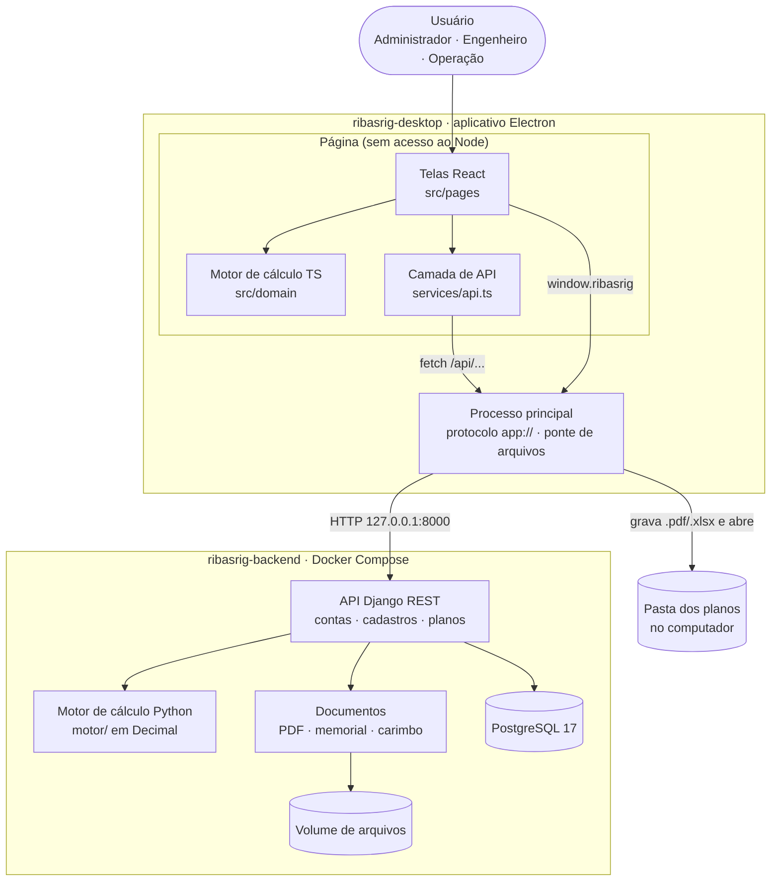

| parte | responsabilidade | não faz |
|---|---|---|
| Telas (React) | formulários, validação de campo, prévia dos cálculos, mensagens | não decide emissão nem permissão |
| Motor TS (`src/domain`) | mesmo cálculo do servidor, para o resultado aparecer ao digitar | não é a fonte oficial dos números |
| API Django | dados, permissões, numeração, recálculo, emissão, revisões, PDFs | não grava no computador do usuário |
| Motor Python (`motor/`) | cálculo oficial em `Decimal`, checklist e bloqueios | não conhece HTTP nem banco |
| Aplicativo Electron | janela segura, repasse de `/api`, gravar e abrir documentos na pasta do plano | não guarda dados de negócio |

| camada | tecnologias |
|---|---|
| Telas | React 19, TypeScript 5.9 (strict), Material UI 9, React Router 7, Vite 8 |
| Servidor | Python 3.13, Django 5.2 LTS, Django REST Framework 3.16, SimpleJWT, gunicorn |
| Banco | PostgreSQL 17 |
| Documentos | ReportLab (páginas geradas), pypdf (junta os anexos), openpyxl (planilha do carimbo) |
| Aplicativo | Electron 44, electron-builder (instalador NSIS do Windows) |
| Infraestrutura e testes | Docker Compose, GitHub Actions, Vitest, pytest, node:test |

---

## 2. Onde cada parte roda

> **Hoje × cenário ideal.** Por enquanto o sistema foi testado e roda **só em máquina local**: aplicativo e servidor
> no mesmo computador, com o servidor escutando só em `127.0.0.1` (nada fica exposto na rede). O **cenário ideal é
> um servidor dedicado para o back-end** (ex.: uma VPS), com um banco só para toda a equipe. Essa implantação ainda
> não foi feita nem testada.

**Hoje: máquina local.**

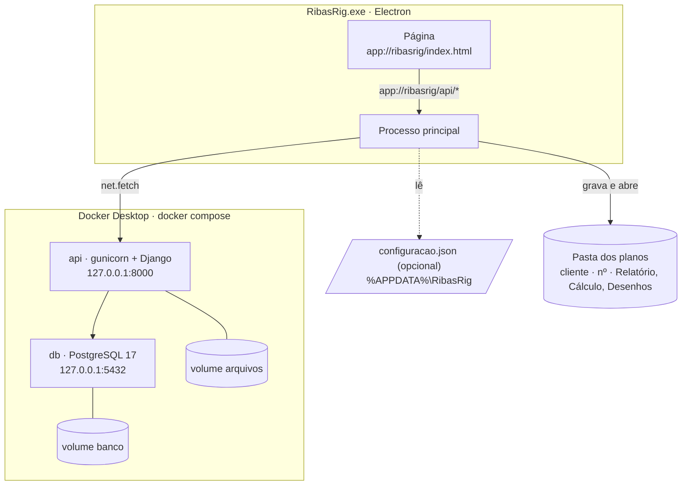

- **Mesma origem:** a página e a API aparecem no mesmo endereço (`app://ribasrig`), então o front usa caminhos
  relativos (`/api/...`) sem CORS, tanto no aplicativo quanto no desenvolvimento (onde o Vite faz o repasse).
- **Dados de negócio só no servidor** (volumes `banco` e `arquivos`). A pasta dos planos tem cópias dos documentos
  para o engenheiro trabalhar com elas, como já fazia.
- O endereço da API é configurável (`configuracao.json` ou `RIBASRIG_API_URL`): `http://127.0.0.1` ou um `https://`.

**Cenário ideal: servidor dedicado (ainda não testado).** O mesmo Docker Compose vai para um servidor Linux. Na
frente dele fica um proxy HTTPS, e os computadores da empresa só têm o aplicativo e a pasta dos planos:

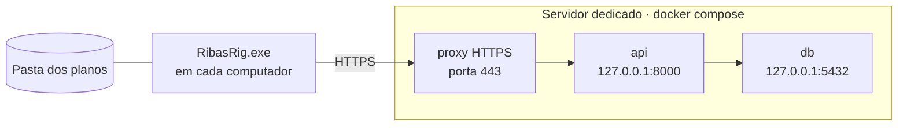

- Para passar de um cenário ao outro não é preciso mudar código. Mudam o `.env` do servidor (domínio, proxy, data
  real) e o `configuracao.json` de cada computador (endereço `https://`): ver
  [docs/backend.md](docs/backend.md#servidor-dedicado-vps).

---

## 3. Front-end (`ribasrig-frontend`)

React 19 + TypeScript (strict) + Material UI 9, com Vite. A regra principal: **nenhuma conta dentro das telas**. Toda
regra de negócio fica em `src/domain` (TypeScript puro, testável sem navegador), e todo acesso a dados passa por
`src/services/api.ts`.

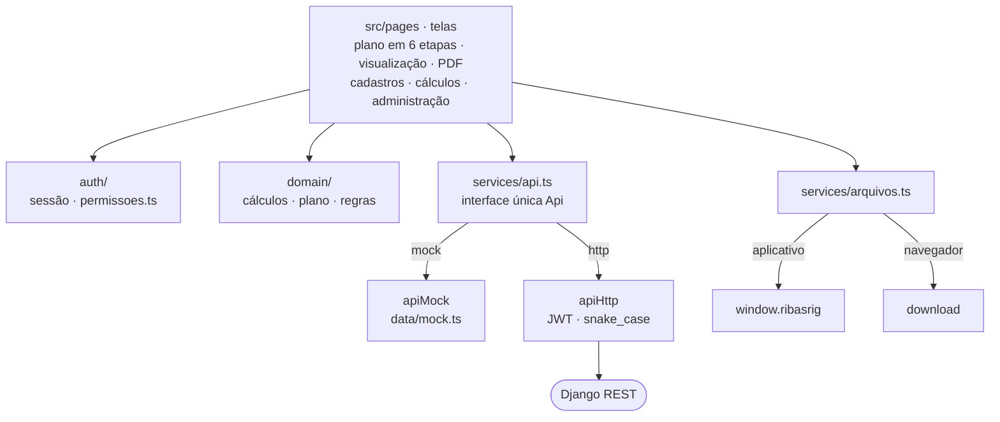

- **Dois modos, a mesma interface.** `apiMock` e `apiHttp` têm a mesma assinatura (`type Api`); o build escolhe por
  `VITE_API`. O mock serviu para construir e testar as telas antes do servidor existir e continua sendo a
  demonstração sem servidor. No build `http` (o do aplicativo), o mock e os dados de exemplo ficam fora do pacote.
- **Sessão:** o token de acesso (curto) fica só em memória; o refresh no `sessionStorage`. Um 401 renova o
  token uma vez e repete a chamada; sem renovação, a tela volta para o login. Ao abrir, o perfil vem de
  `GET /api/auth/me/`, não do que estava salvo no navegador.
- **"Hoje" do servidor:** antes de montar as telas, o front pega a data em `GET /api/sistema/`, para os avisos de
  laudo e inspeção usarem a mesma data das regras do servidor.
- **Permissões:** `permissoes.ts` é a matriz única (perfil × ação) usada no menu, nos botões e nas rotas. O servidor
  tem a cópia dela e é quem garante.

---

## 4. Back-end (`ribasrig-backend`)

Django 5.2 + Django REST Framework, organizado em apps. O motor de cálculo é um pacote Python puro, sem Django, para
poder ser testado isoladamente e comparado com o do front.

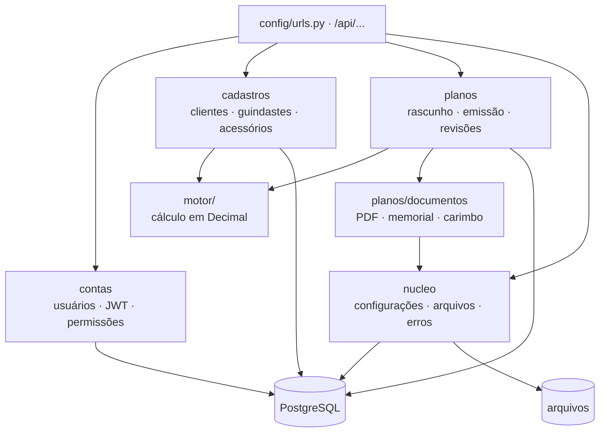

**Contrato da API:** JSON em `snake_case`, `Authorization: Bearer <token>`, e todo erro no formato
`{"detail": "mensagem"}` com o status HTTP certo. O conteúdo de cada app, os endpoints, os códigos de erro e as
variáveis de configuração estão em [docs/backend.md](docs/backend.md).

---

## 5. Aplicativo (`ribasrig-desktop`)

Electron com três camadas separadas. A página não tem acesso ao Node nem ao disco. O preload expõe só cinco funções
(`window.ribasrig`), e o processo principal confere cada pedido antes de mexer em arquivos.

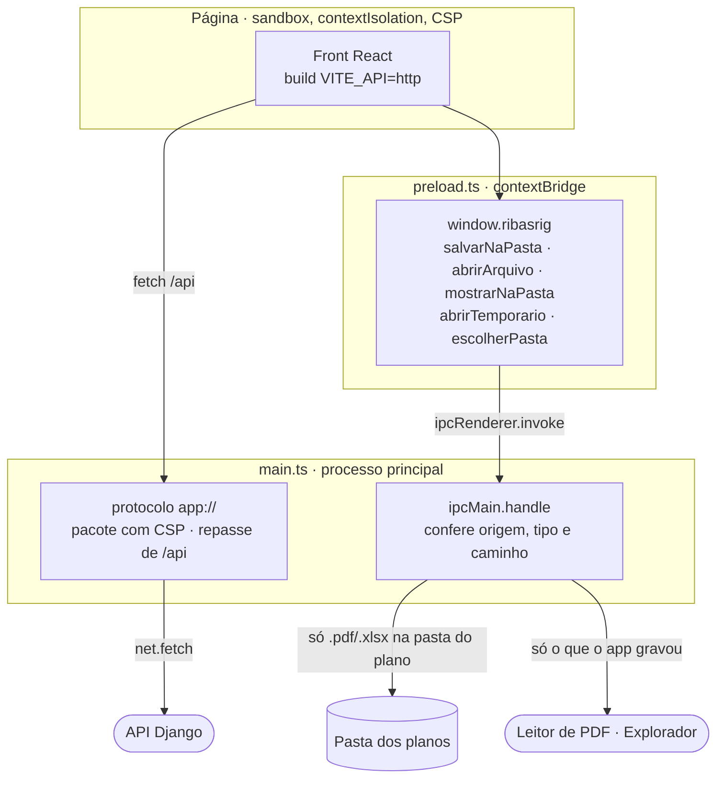

O protocolo `app://ribasrig` entrega o front com CSP e repassa `/api/*` ao servidor; a ponte só grava `.pdf` e
`.xlsx` na pasta do plano e só abre o que gravou. As regras completas, a página de servidor fora do ar e o que fica
bloqueado estão em [docs/desktop.md](docs/desktop.md).

---

## 6. Fluxos principais

### 6.1 Login e sessão

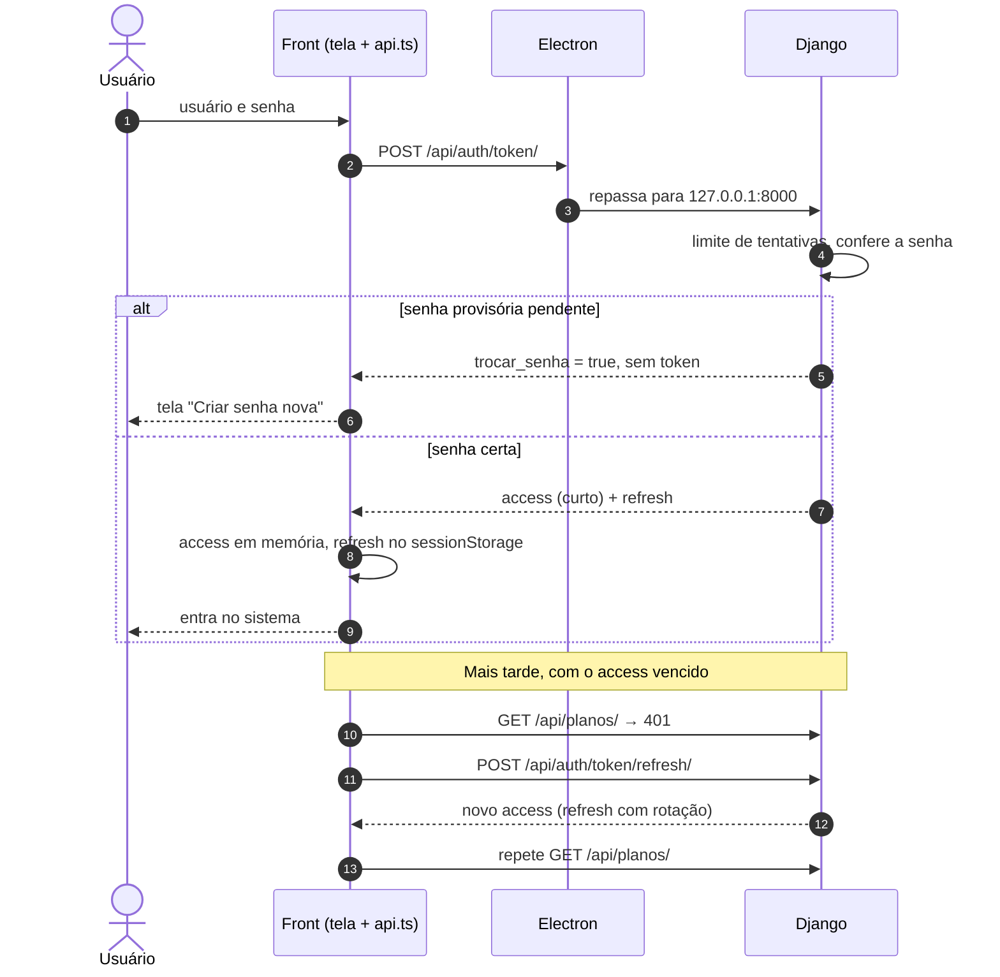

### 6.2 Emissão de um plano

O ponto central do sistema: a tela mostra a prévia, mas **quem decide é o servidor**, que recalcula com os cadastros
atuais e grava revisão, PDF e memorial numa única transação.

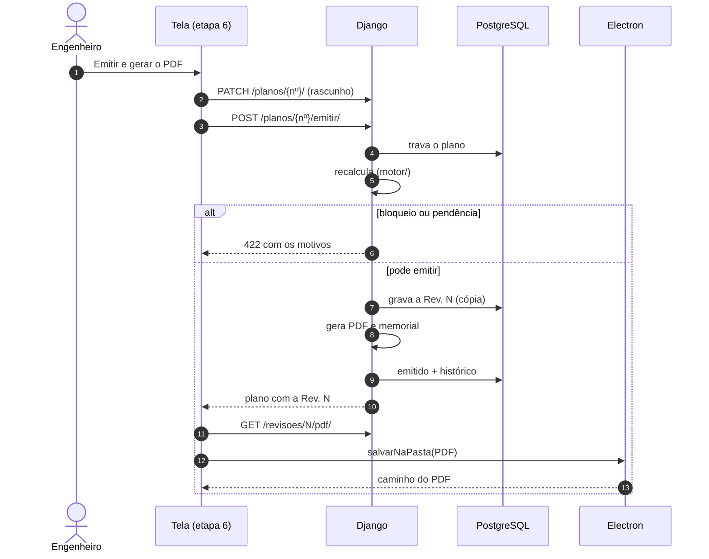

Se qualquer passo falhar (um anexo ilegível, por exemplo), a transação é desfeita e o plano continua rascunho.

---

## 7. Ciclo de vida do plano

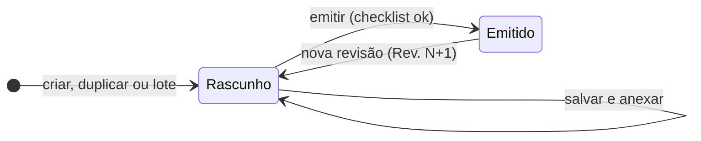

- **Emitir:** com pendência no checklist ou bloqueio (taxa acima do limite, laudo vencido…), o servidor responde 422
  com os motivos e o plano continua rascunho. Depois de emitido, o plano recusa alteração (409) até alguém criar a
  nova revisão; consultar, baixar o PDF e duplicar (que gera outro plano) continuam liberados.
- **Limite da taxa:** 85% por padrão, alterável pelo Administrador em Configurações (com confirmação). O servidor usa o
  limite em vigor ao recalcular e grava na revisão o limite usado; o front recebe o limite em `GET /api/sistema/`, junto
  com o "hoje".
- **Numeração:** AAMM + 3 dígitos pela data de criação, zerando todo mês. A linha do mês é travada
  (`SELECT … FOR UPDATE`), então dois usuários nunca recebem o mesmo número; o lote não passa para o mês seguinte.
- **Revisão imutável:** a revisão guarda a cópia das entradas (dados do plano, contratante, guindaste, acessórios com
  capacidade, gráfico usado, versões das regras, empresa, responsável e arquivos) e dos resultados. Ela é imutável
  no model e no banco (um trigger do PostgreSQL recusa `UPDATE` e `DELETE`). Mudar um
  cadastro depois **não muda** um plano emitido nem os seus documentos.

---

## 8. Modelo de dados

Os planos e o que fica guardado em cada emissão (os nomes seguem os models do Django e os tipos de
`src/domain/types.ts`):

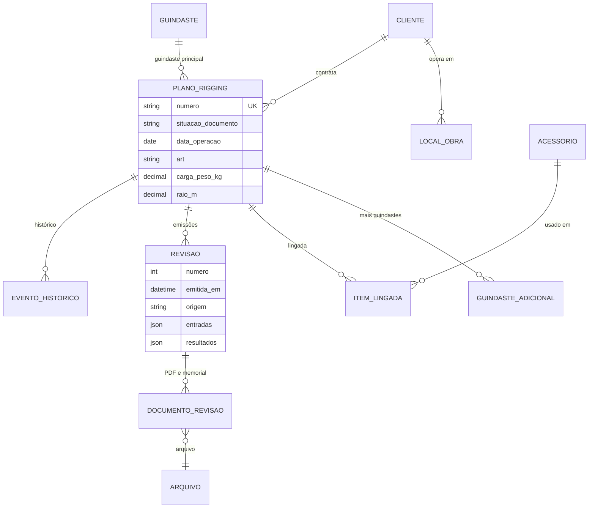

- `numero` é único (AAMM + 3 dígitos); `situacao_documento` é rascunho ou emitido; `art` tem 13 dígitos.
- `REVISAO.origem` diz se a revisão foi emitida pelo sistema ou importada do Excel; `entradas` e `resultados` são a
  cópia do que foi usado e do que foi calculado na emissão.

Os cadastros que alimentam o cálculo (o guindaste guarda `a`, `b` e `Pg` para as sapatas; o acessório guarda tipo,
capacidade de trabalho, peso, situação, próxima inspeção e vencimento):

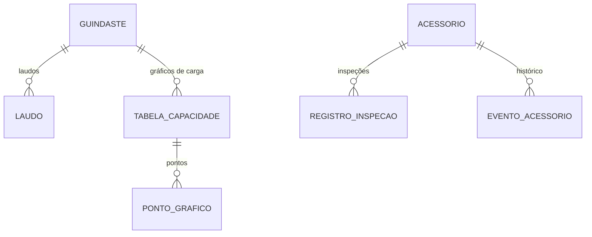

As regras de cálculo do engenheiro e os tipos de içamento que as aplicam (cada gravação de uma regra vira uma versão;
os planos emitidos guardam a versão usada):

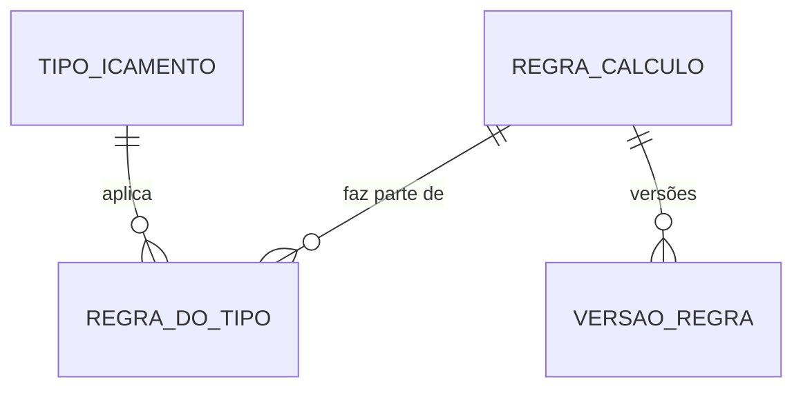

Outras tabelas: `Usuario` (perfil, senha provisória), `Configuracoes` (linha única: pasta, empresa, responsável,
logo), `PadraoInspecao` (itens por tipo de acessório), `UsoCadastro` (quais planos emitidos usaram cada acessório,
tipo e regra) e `SequenciaMensal` (trava da numeração). Todas as medidas são `numeric` no PostgreSQL (`DecimalField`):
nada é guardado como `float`.

---

## 9. Geração dos documentos

Os documentos saem **só da cópia gravada na revisão** (`Revisao.entradas`), nunca do cadastro atual.

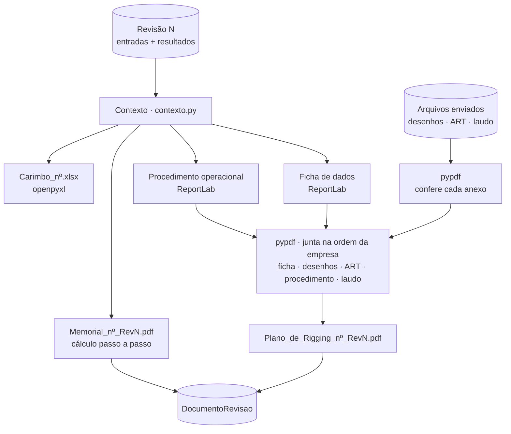

O PDF do plano e o memorial são gerados na emissão; a planilha do carimbo, quando pedida. As regras de cada um (anexo
ilegível, página de aviso, fontes, nomes das células) estão em "Documentos gerados" de [docs/backend.md](docs/backend.md#documentos-gerados).

---

## 10. Segurança

| risco | proteção | onde |
|---|---|---|
| Acesso sem permissão | permissão conferida em toda rota pela matriz de perfis; o front só esconde botões | `contas/permissoes.py` |
| Adivinhar senhas | limite de tentativas por IP no login e na troca de senha, sem confiar em `X-Forwarded-For` | `contas/views.py`, `settings.py` |
| Token roubado | access curto só em memória; refresh rotativo com lista de bloqueio; trocar a senha derruba os tokens | `api.ts`, SimpleJWT |
| Senha provisória | aleatória, de uso único e com validade; sem token até a troca | `contas/servicos.py` |
| Upload malicioso | tipo conferido pelos bytes (`%PDF-`, PNG, JPEG), tamanho máximo, nome no disco gerado pelo servidor, fora de pasta pública; SVG recusado | `nucleo/arquivos.py` |
| Fórmula maliciosa | avaliador próprio (sem `eval`), com limite de tamanho, de expoente e de aninhamento | `motor/regras.py`, `domain/regras.ts` |
| Alterar plano entregue | revisão imutável no model e no banco (trigger) | `planos/models.py`, migração 0002 |
| Duas emissões com a mesma ART ou o mesmo número | travas no banco (`SELECT … FOR UPDATE`) e restrição única | `planos/servicos.py` |
| Texto do usuário quebrando o PDF | escape de todo texto antes do ReportLab | `pdf_plano.py` |
| Página com acesso ao computador | `contextIsolation`, `sandbox`, sem Node, CSP, navegação e janelas bloqueadas | `ribasrig-desktop/src/main.ts` |
| Gravar ou abrir arquivo indevido | ponte só grava `.pdf`/`.xlsx` na pasta do plano e só abre o que gravou | `ribasrig-desktop/src/arquivos.ts` |
| Exposição na rede | API e banco escutam só em `127.0.0.1`; num servidor dedicado, só o proxy HTTPS (443) fica aberto | `docker-compose.yml` |

---

## 11. Decisões técnicas

| decisão | por quê |
|---|---|
| Recalcular no servidor antes de emitir | a tela pode estar desatualizada ou ser manipulada; o número que vai para o cliente precisa vir de um lugar só |
| Motor em dois lugares (TS e Python) | prévia instantânea ao digitar sem esperar o servidor; testes comparam os dois com os valores do plano 2607036 (diferença abaixo de 1e-12) |
| `Decimal` no servidor e `numeric` no banco | sem erro de ponto flutuante nos valores que vão para o documento técnico |
| Revisão com cópia completa + trigger | rastreabilidade: o documento entregue pode ser regenerado igual, mesmo que os cadastros mudem |
| PDF gerado na emissão, na mesma transação | ou existe a revisão com os documentos, ou não existe nada |
| Mock e servidor atrás da mesma interface (`VITE_API`) | o front foi construído e testado antes do back-end existir; a troca não mexeu nas telas |
| Protocolo `app://` em vez de `file://` | mesma origem para página e API (sem CORS), CSP aplicada e nenhum acesso amplo ao disco |
| Servidor local em Docker Compose | instalação igual em qualquer computador, sem depender de internet; os dados ficam na empresa |
| Erros sempre `{"detail"}` com status HTTP | a tela mostra a mensagem do servidor sem tradução própria |

---

## 12. Qualidade e testes

Cada camada é testada onde a regra mora, e o teste de ponta a ponta liga as duas cópias do motor:

| nível | ferramenta | o que cobre |
|---|---|---|
| Motor (servidor) | pytest | cálculo do plano 2607036 e casos de borda (85,00% passa, 85,06% bloqueia, limite configurável, laudo vencido, raio fora do gráfico, fórmulas) |
| API | pytest + PostgreSQL | endpoints, permissões por perfil, numeração, emissão, revisão imutável, uploads, documentos, limite de login, formato dos erros |
| Domínio e telas | Vitest | regras em TypeScript, cliente HTTP, lógica das telas |
| Ponta a ponta | Vitest + servidor real | front e servidor juntos: criar, anexar, emitir, comparar resultados |
| Aplicativo | node:test + teste de fumaça | regras de caminho, protocolo, isolamento, ponte, proxy |

Os comandos, a quantidade de testes e os workflows de CI estão no [README](README.md#testes).
