# Guia do usuário · Sistema RibasRig

Este guia é para quem vai usar o RibasRig pela primeira vez: o engenheiro que faz os planos, quem consulta e quem
administra o sistema. Ele segue a ordem do dia a dia: entrar, conhecer a tela inicial, montar um plano, emitir e
cuidar dos cadastros.

As imagens são do sistema real, com o **cenário de exemplo** carregado (plano 2607036 e cadastros da Guindastes Ribas;
"hoje" = 07/10/2026). Para instalar e ligar o sistema, veja o [README](README.md).

**Sumário:** [1. Conceitos](#1-conceitos) · [2. Entrar no sistema](#2-entrar-no-sistema) ·
[3. Tela inicial](#3-tela-inicial) · [4. Montar um plano](#4-montar-um-plano-de-rigging-passo-a-passo) ·
[5. Depois de emitir](#5-depois-de-emitir) · [6. Lote e consulta rápida](#6-planos-em-lote-e-consulta-rápida) ·
[7. Cadastros](#7-cadastros) · [8. Cálculos](#8-cálculos-regras-e-tipos-de-içamento) ·
[9. Administração](#9-administração) · [10. Onde ficam os arquivos](#10-onde-ficam-os-arquivos) ·
[11. Problemas comuns](#11-problemas-comuns)

---

## 1. Conceitos

O RibasRig substitui a planilha de Excel usada para os planos de rigging. Ele **calcula sozinho**, **confere os
limites de segurança** e **não deixa emitir** um plano com problema (taxa acima do limite, laudo vencido, anexo
faltando…). Cada emissão vira uma revisão guardada exatamente como foi entregue.

| termo | o que é |
|---|---|
| **Plano de Rigging** | Documento que descreve e justifica um içamento: carga, acessórios, guindaste, raio, cálculos. Número no formato AAMM + 3 dígitos (ex.: 2610001 = 1º plano de outubro/2026), gerado pelo sistema. |
| **Rascunho / Emitido** | Rascunho pode ser editado. Emitido é somente leitura: para mudar algo, cria-se uma nova revisão. |
| **Revisão (Rev.)** | Cada emissão do mesmo plano: Rev. 1, Rev. 2… As anteriores continuam guardadas. |
| **Carga bruta (Pb)** | Carga + lingada + balancim/dispositivos + cargas extras, em kg. |
| **Capacidade no raio** | Quanto o guindaste levanta na distância de operação, lida do gráfico de carga do fabricante (com interpolação). |
| **Taxa de utilização (TU)** | Quanto da capacidade está sendo usado. Com os valores padrão: até 74,99% = dentro do limite; de 75% a 85% = atenção; **acima de 85% = bloqueado**. O limite e o início da atenção são definidos pelo Administrador em Configurações. |
| **Lingada** | Conjunto de acessórios que prende a carga ao gancho: cintas, manilhas, laços de cabo de aço. |
| **Balancim** | Viga que abre as pernas da lingada em cargas largas (tipo "balancim · 4 pernas + 2 superiores"). |
| **Laudo** | Inspeção do guindaste com validade. Laudo vencido na data da operação bloqueia o plano. |
| **ART** | Anotação de Responsabilidade Técnica do CREA-PR. A ART do plano tem 13 dígitos e não pode repetir a de outro plano. |
| **Sapatas e RMET** | Esforço que o guindaste faz no chão (kgf) e a resistência mínima que o terreno precisa ter (kgf/cm²). |
| **Memorial de cálculo** | Documento interno com todas as contas passo a passo. Não vai para o cliente. |

### Perfis de acesso

| ação | Administrador | Engenheiro | Operação |
|---|:-:|:-:|:-:|
| Consultar planos e baixar o PDF | ✓ | ✓ | ✓ |
| Criar e editar rascunhos, emitir, criar nova revisão | ✓ | ✓ | — |
| Ver memorial de cálculo e histórico | ✓ | ✓ | — |
| Editar cadastros (guindastes, clientes, acessórios, cálculos) | ✓ | ✓ | — |
| Gerenciar usuários e alterar configurações | ✓ | — | — |

O sistema esconde o que o perfil não pode fazer, e o servidor recusa mesmo que alguém tente por fora da tela.

---

## 2. Entrar no sistema

Abra o **RibasRig** pelo atalho na área de trabalho. O servidor precisa estar ligado. Hoje ele roda no próprio
computador, pelo Docker Desktop (no futuro, a ideia é um servidor dedicado na internet). Se não estiver no ar, o
aplicativo mostra esta página e tenta de novo sozinho a cada 5 segundos:

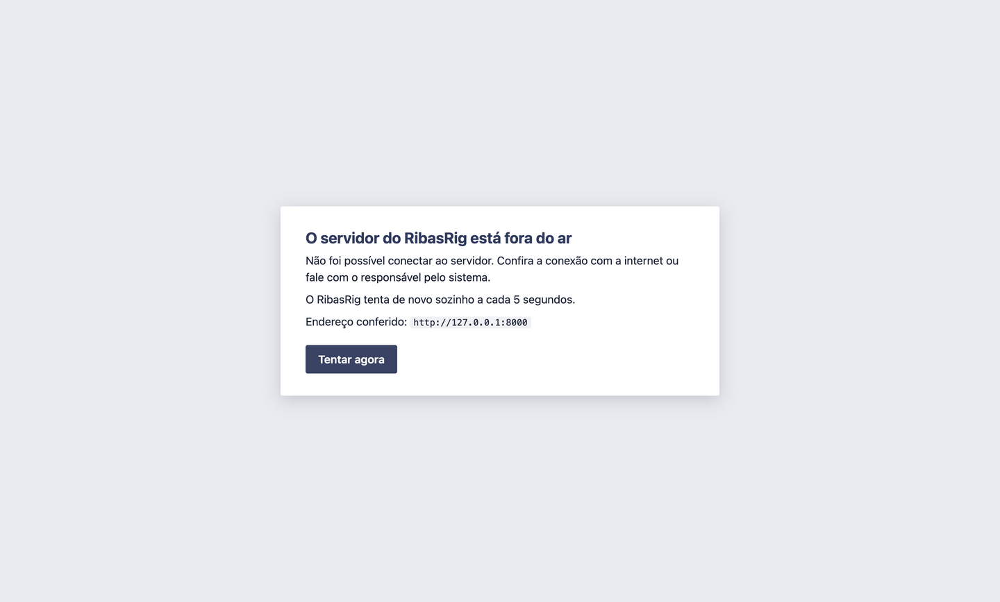

### Login

Entre com **usuário** e **senha** (não há e-mail). O olho ao lado da senha mostra o que foi digitado.

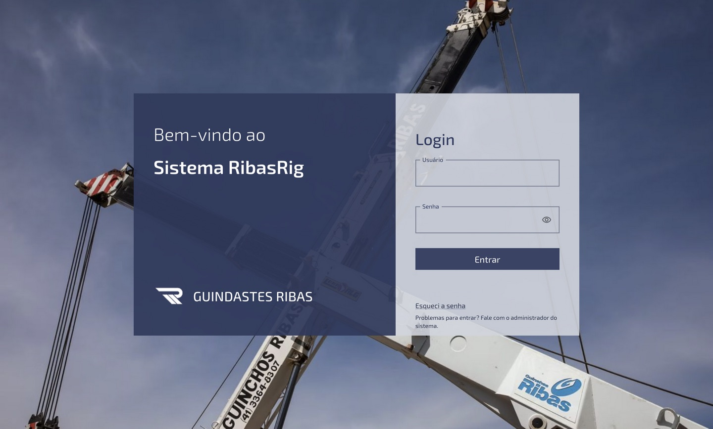

- Errou várias vezes seguidas? O sistema pede para esperar alguns segundos antes de tentar de novo.
- A sessão vale até você sair (botão ao lado do seu nome, no canto inferior do menu) ou fechar o aplicativo; depois
  de muitas horas sem sair, o sistema pede o login de novo.

### Primeiro acesso e "Esqueci a senha"

O administrador cria o usuário e recebe uma **senha provisória** (aparece uma vez só). No primeiro login com ela, o
sistema leva para a tela de **criar a senha nova**:

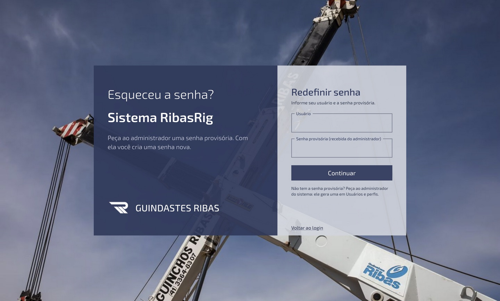

1. Informe o usuário e a senha provisória.
2. Crie a senha nova: **8 caracteres ou mais, com letras e números**, diferente da provisória.
3. Volte ao login e entre com a senha nova.

Esqueceu a senha? Peça ao administrador uma nova senha provisória (tela Usuários) e faça os mesmos passos. A senha
provisória vale por 48 horas.

### Atalhos de teclado

| teclas | ação |
|---|---|
| `Ctrl` + `/` | lista de atalhos |
| `/` ou `Ctrl` + `K` | buscar plano |
| `Alt` + `N` | novo plano |
| `Ctrl` + `Enter` · `Alt` + `←` | próxima etapa · etapa anterior (na tela do plano) |
| `Ctrl` + `S` · `Ctrl` + `P` | salvar rascunho · visualizar PDF (na tela do plano) |
| `Esc` | fechar janela |

---

## 3. Tela inicial

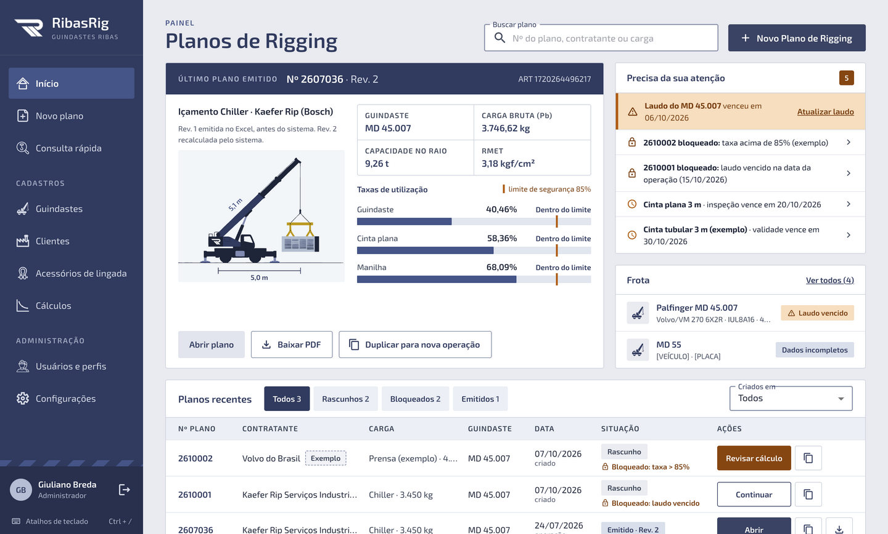

- **Último plano emitido:** o desenho do içamento, os números principais (guindaste, carga bruta, capacidade no raio,
  RMET) e as barras de taxa com a marca do limite (85%, no padrão). Botões para abrir, baixar o PDF ou duplicar para uma nova
  operação.
- **Precisa da sua atenção:** o que pode travar um plano. Laudo vencido ou vencendo, planos bloqueados com o motivo,
  acessórios com inspeção ou validade perto do fim. Clique para ir direto ao ponto.
- **Frota:** cada guindaste com a situação do laudo.
- **Planos recentes:** abas Todos, Rascunhos, Bloqueados e Emitidos; filtro por data de criação; busca por número,
  contratante ou carga. A coluna Ações mostra o próximo passo (Continuar, Revisar cálculo, Abrir).

---

## 4. Montar um plano de rigging (passo a passo)

**Antes:** o contratante precisa estar em Clientes, o guindaste em Guindastes (com gráfico de carga e laudo) e os
acessórios em Acessórios de lingada. Veja a [seção 7](#7-cadastros).

Clique em **+ Novo Plano de Rigging** (ou `Alt` + `N`). O plano tem **6 etapas**, que podem ser abertas em qualquer
ordem pela barra do topo. Em todas elas:

- O **número do plano** é gerado no primeiro salvamento e nunca é digitado.
- O rascunho é **salvo automaticamente** ("Rascunho salvo automaticamente às 18h49", no canto superior direito).
- O **Resumo dos cálculos**, à direita, atualiza enquanto você digita: carga bruta, capacidade no raio, taxa do
  guindaste e de cada acessório, sapatas, RMET e a situação (com o motivo, quando bloqueado).
- Números aceitam vírgula ou ponto. Quando há ponto, o campo mostra **"lido como …"** para você conferir.
- Um ✓ na etapa indica que ela está completa; um **!** laranja indica pendência.

### Etapa 1 · Dados gerais

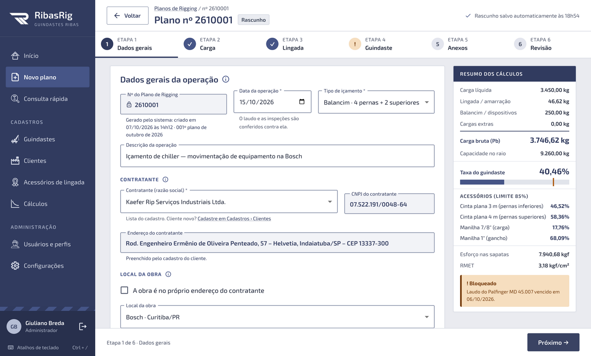

- **Data da operação:** o laudo do guindaste e as inspeções dos acessórios são conferidos contra ela.
- **Tipo de içamento** (com ou sem balancim) e **descrição da operação**.
- **Contratante** (do cadastro de clientes): CNPJ e endereço vêm preenchidos.
- **Local da obra:** pode ser o próprio endereço do contratante ou um dos locais cadastrados para ele (por exemplo,
  a Kaefer contrata e a operação é na Bosch).
- **Rigger** e **nº da ART do plano** (13 dígitos). O botão **Dados para a ART** reúne tudo que o portal do CREA pede,
  com botões de copiar.

### Etapa 2 · Carga

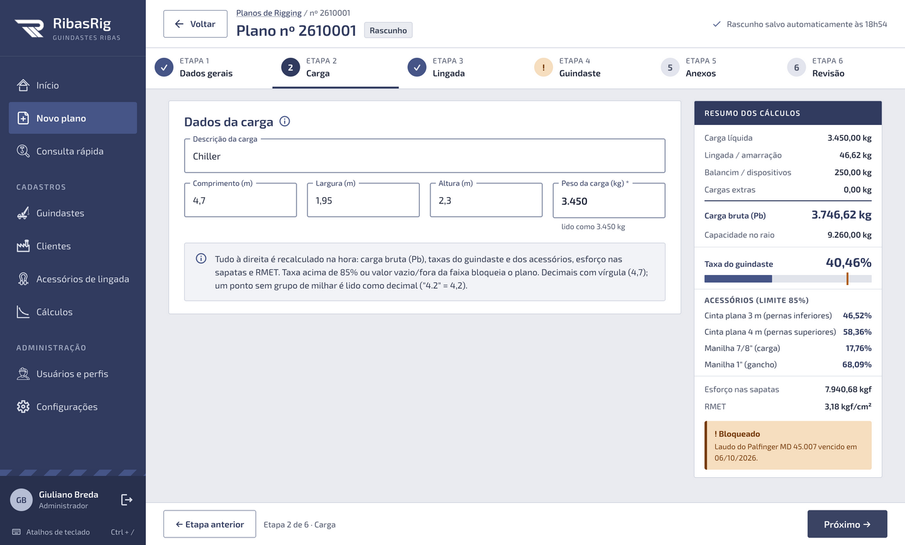

Descrição, comprimento, largura, altura e **peso da carga** (1 a 100.000 kg).

### Etapa 3 · Lingada

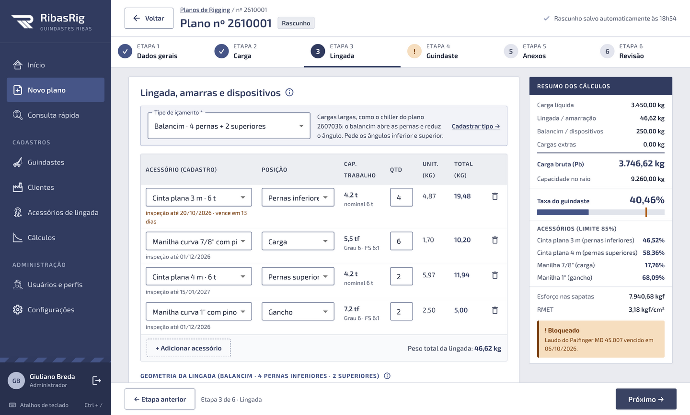

- Escolha os **acessórios do cadastro**, a **posição** de cada um (pernas inferiores, pernas superiores, carga,
  gancho) e a **quantidade**. Capacidade de trabalho, peso e inspeção vêm do cadastro.
- Informe os **ângulos das pernas, medidos a partir da vertical** (0° a 60°).
- Nos tipos com balancim: peso do balancim/dispositivos. Em todos: **cargas extras**, se houver.
- A tabela de tração mostra, para cada posição, a fórmula, a tração, a capacidade e a taxa.

Acessório vencido, descartado ou inativo não pode ser escolhido.

### Etapa 4 · Guindaste

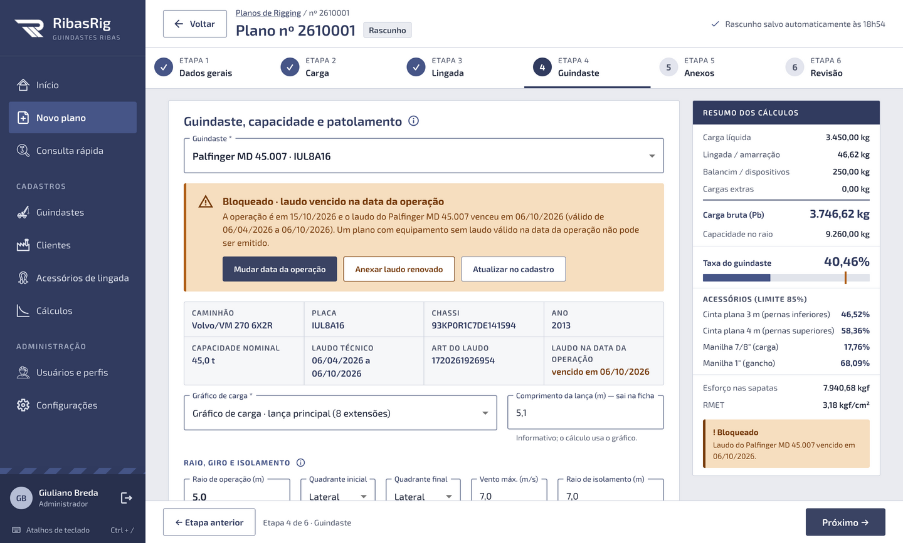

- **Guindaste** e **gráfico de carga** (a configuração da lança). Os dados do caminhão e do laudo vêm do cadastro.
- **Raio de operação**, quadrantes, vento máximo e **raio de isolamento** (não pode ser menor que o raio).
- A **capacidade no raio** aparece com a conta passo a passo e o ponto destacado no gráfico. Raio fora do gráfico
  bloqueia.
- **Laudo vencido na data da operação** (como no exemplo acima): mude a data, use **Anexar laudo renovado** (informe
  a nova validade e escolha o PDF; o laudo vai para o cadastro na emissão) ou **Atualizar no cadastro**.
- **+ Adicionar outro guindaste** para içamentos com mais de um guindaste (a soma dos percentuais vai até 100%).
- **Sapatas:** largura, comprimento e quantidade de dormentes. O resultado é o esforço nas sapatas e o RMET.

### Etapa 5 · Anexos

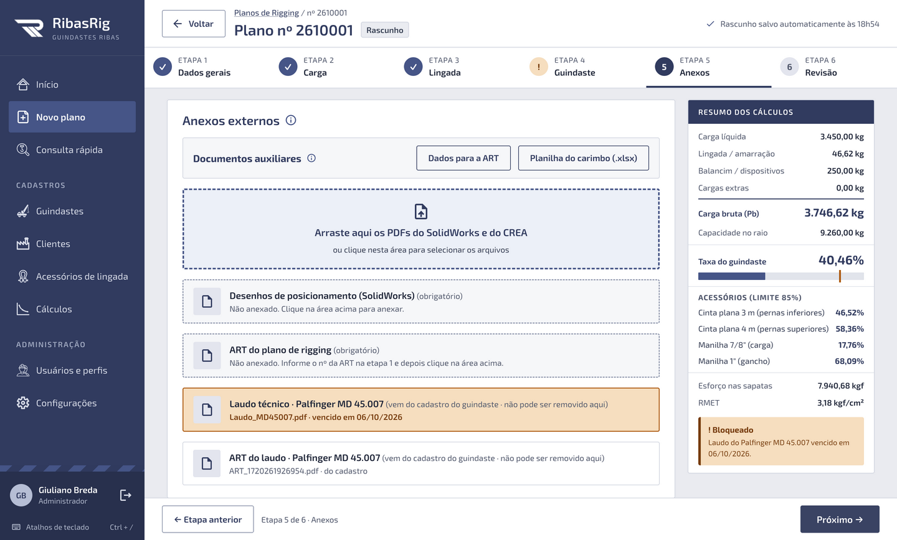

- **Arraste os PDFs** para a área tracejada (ou clique nela): os **desenhos de posicionamento** (SolidWorks) e a
  **ART do plano**. O arquivo da ART precisa se chamar `ART_<nº da ART>.pdf`, com o mesmo número da etapa 1.
- O servidor confere se o arquivo é mesmo um PDF; um arquivo corrompido é recusado com uma mensagem.
- O **laudo** e a **ART do laudo** do guindaste vêm do cadastro e não são removidos aqui.
- **Planilha do carimbo (.xlsx):** grava, na pasta Desenhos do plano, uma planilha com os dados do plano (nº, ART,
  esforço nas sapatas…) para vincular ao carimbo dos desenhos no SolidWorks.

### Etapa 6 · Revisão e emissão

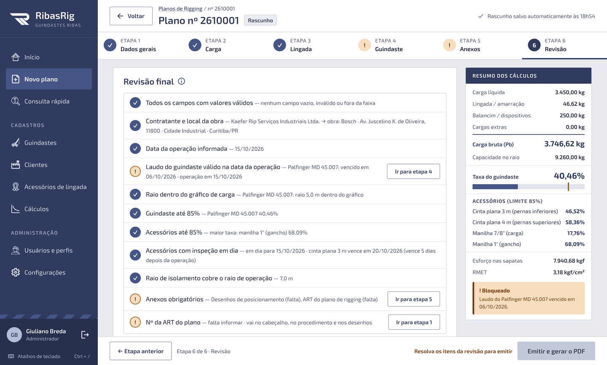

O **checklist** confere tudo de novo: campos válidos, contratante e local, data, laudo, raio dentro do gráfico,
guindaste e acessórios até o limite, inspeções em dia, isolamento, anexos e ART. Cada item pendente tem o botão
**Ir para etapa N**.

Com tudo aprovado, **Emitir e gerar o PDF**:

1. O servidor **refaz todos os cálculos** com os cadastros atuais (a tela não decide sozinha).
2. Cria a **Rev. N**, com uma cópia completa de tudo que foi usado.
3. Gera o **PDF do plano** (ficha de dados → desenhos → ART → procedimento operacional → laudo) e o **memorial de
   cálculo**.
4. O aplicativo grava o PDF na pasta do cliente (`…\<cliente>\<nº>\Relatório\`).

A partir daí o plano é **somente leitura**.

---

## 5. Depois de emitir

### Visualização do plano

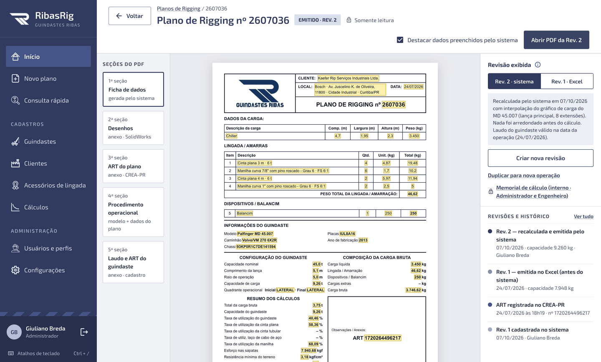

- O documento como sai no PDF. **Destacar dados preenchidos pelo sistema** realça em amarelo o que veio dos cálculos e
  dos cadastros.
- **Revisão exibida:** alterna entre as revisões. No exemplo, a Rev. 1 foi emitida no Excel (com o erro de
  interpolação: 7.948 kg) e a Rev. 2 recalculada pelo sistema (9.260 kg).
- **Criar nova revisão:** reabre o plano como rascunho da Rev. N+1, com o mesmo número.
- **Duplicar para nova operação:** novo plano, novo número, com os dados copiados (sem ART e anexos).

### PDF do plano

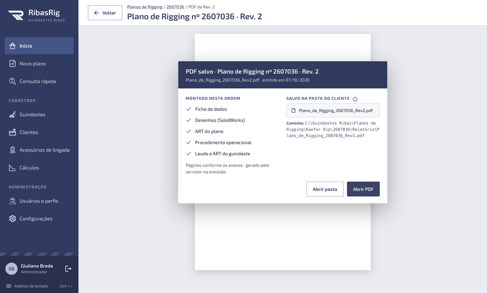

**Abrir PDF** grava o arquivo na pasta do cliente e abre no leitor de PDF do computador. **Abrir pasta** mostra o
arquivo no Explorador de Arquivos (no Mac, no Finder). O nome segue o modelo das Configurações
(`Plano_de_Rigging_{nº}_Rev{rev}.pdf`).

### Memorial de cálculo (interno)

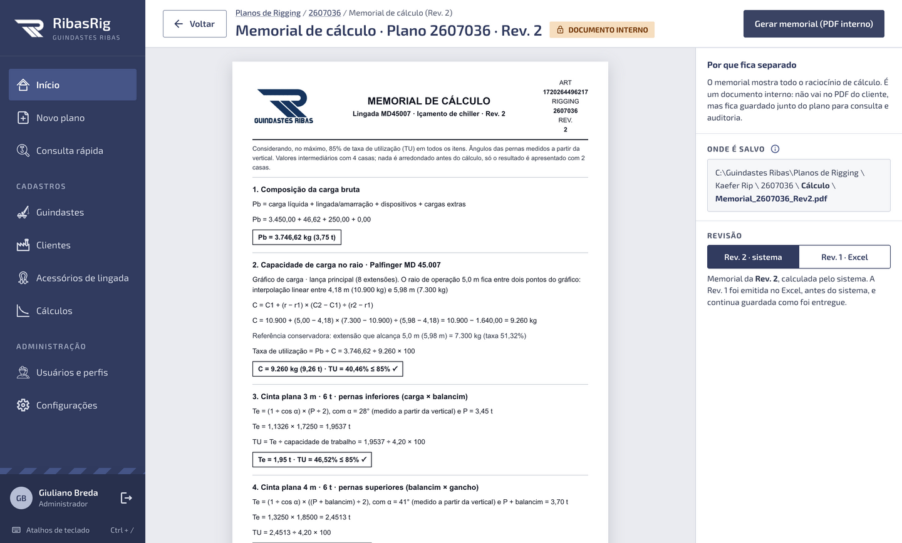

Todo o raciocínio: composição da carga bruta, interpolação no gráfico, trações por posição, sapatas e RMET. **Gerar
memorial (PDF interno)** grava o arquivo na pasta **Cálculo** do plano. Só Administrador e Engenheiro veem.

### Histórico de alterações

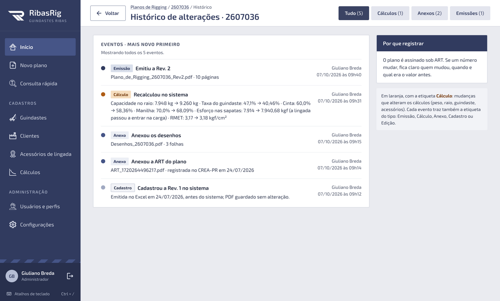

Quem fez o quê e quando: criação, anexos, cálculos, emissões. Filtros por tipo.

---

## 6. Planos em lote e consulta rápida

### Planos em lote

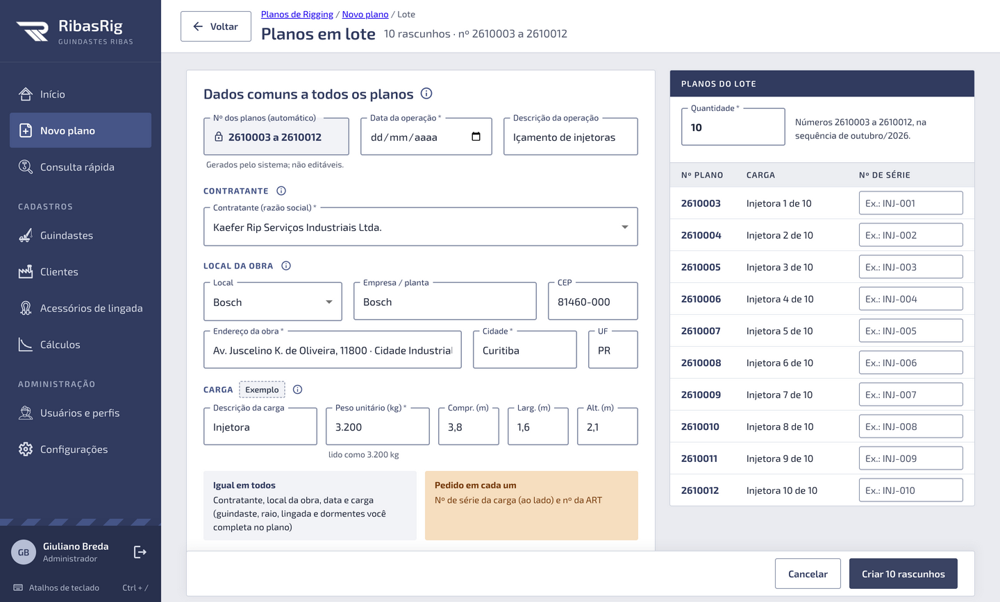

Para operações repetidas (por exemplo, 10 máquinas iguais): preencha uma vez e escolha a quantidade (1 a 50). O sistema
cria os rascunhos com números em sequência, sem passar para o mês seguinte.

### Consulta rápida

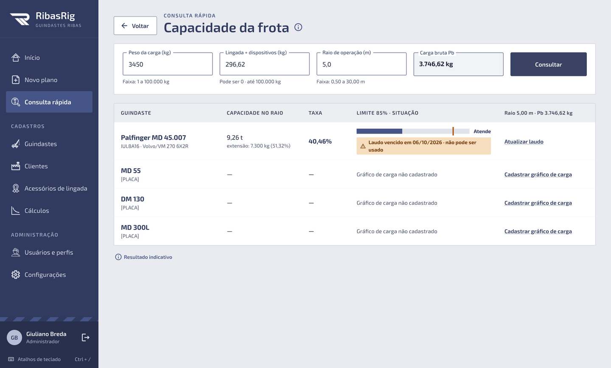

"Qual guindaste dá conta?" sem criar plano: informe o peso, a lingada e o raio. Para cada guindaste da frota aparece a
capacidade e a situação: Atende, Atende perto do limite, Não atende, Raio fora do gráfico ou Gráfico não cadastrado.
O resultado é indicativo; o plano oficial passa pelas 6 etapas.

---

## 7. Cadastros

Todos veem os cadastros; Administrador e Engenheiro editam. As mudanças valem para os **próximos** planos: um plano já
emitido guarda a cópia do que usou.

### Guindastes

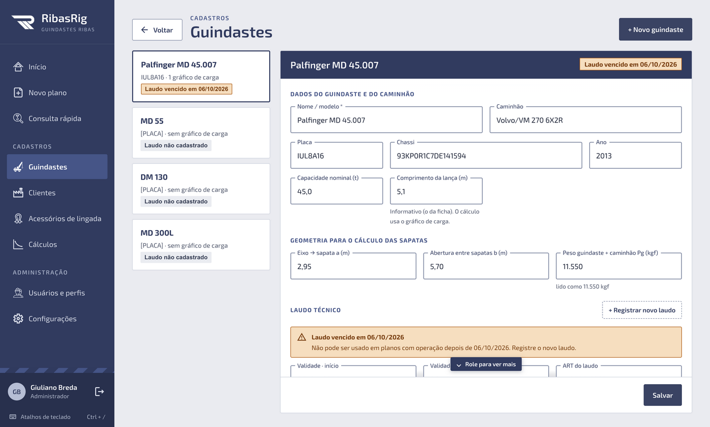

- Dados do guindaste e do caminhão; **a**, **b** e **Pg** (usados no cálculo das sapatas).
- **Laudo técnico:** validade (início e fim), ART do laudo e o **PDF do laudo**. **+ Registrar novo laudo** manda o
  atual para o histórico ao salvar. Sem o PDF guardado, o laudo conta como **faltando** no checklist do plano e a
  emissão fica bloqueada; se o envio do PDF falhar, anexe de novo e salve.
- **Gráfico escolhido no plano:** se o gráfico for apagado ou trocado de nome, os planos que o usavam ficam
  bloqueados com "sem gráfico de carga" até alguém escolher o gráfico de novo na etapa Guindaste.
- **Gráfico de carga:** para cada configuração da lança, a tabela alcance (m) × capacidade (kg), copiada do manual do
  fabricante. O gráfico é desenhado na hora; linha repetida ou inválida fica marcada.

### Clientes

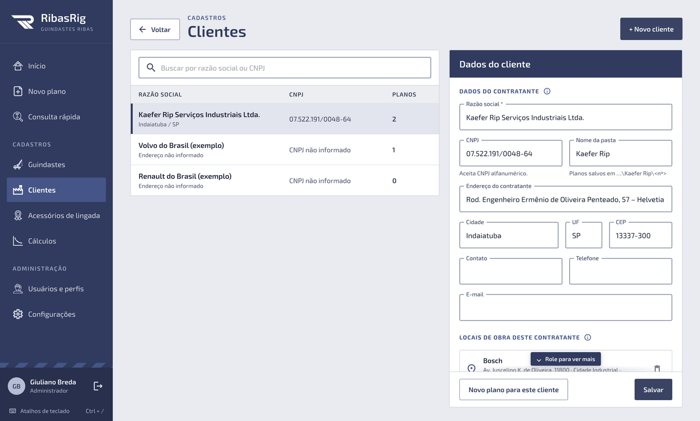

Razão social, CNPJ (conferido), endereço e contato. Os **locais de obra** são os lugares onde o cliente opera, quando
diferentes do endereço dele. O nome da pasta do cliente é usado na pasta dos planos.

### Acessórios de lingada

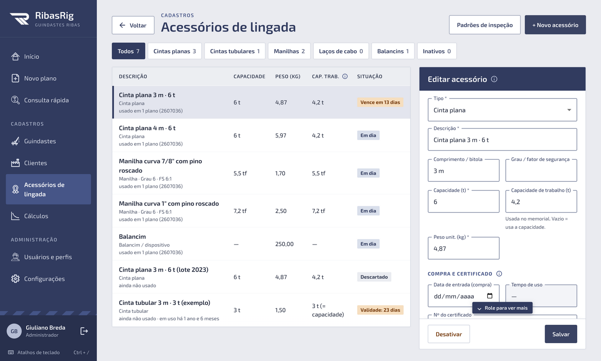

- Abas por tipo e a situação de cada item: em dia, vence em N dias, inspeção vencida, validade vencida, em inspeção,
  descartado, inativo.
- **Capacidade** e **capacidade de trabalho** (a usada no cálculo; não pode passar da nominal), peso unitário.
- **Compra e certificado:** data de entrada, tempo de uso, nº e **PDF do certificado**.
- **Registrar inspeção:** cada item do padrão do tipo marcado como conforme ou não conforme. Aprovado volta para "Em
  uso" com a próxima data; reprovado vai para descarte (com o motivo) ou fica "Em inspeção" para reparo.
- **Padrões de inspeção** (botão no topo): os itens que o inspetor confere em cada tipo de acessório.
- **Desativar** manda o item para a aba Inativos sem apagar o histórico (ele deixa de aparecer nos planos novos);
  **Reativar** traz de volta.

---

## 8. Cálculos: regras e tipos de içamento

| Regras de cálculo | Tipos de içamento |
|---|---|
| 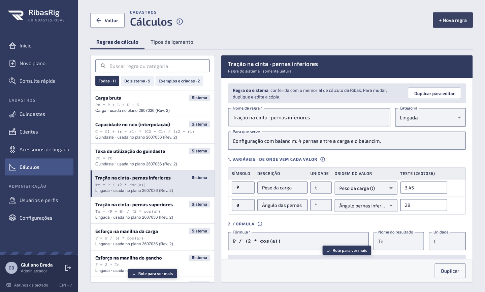 | 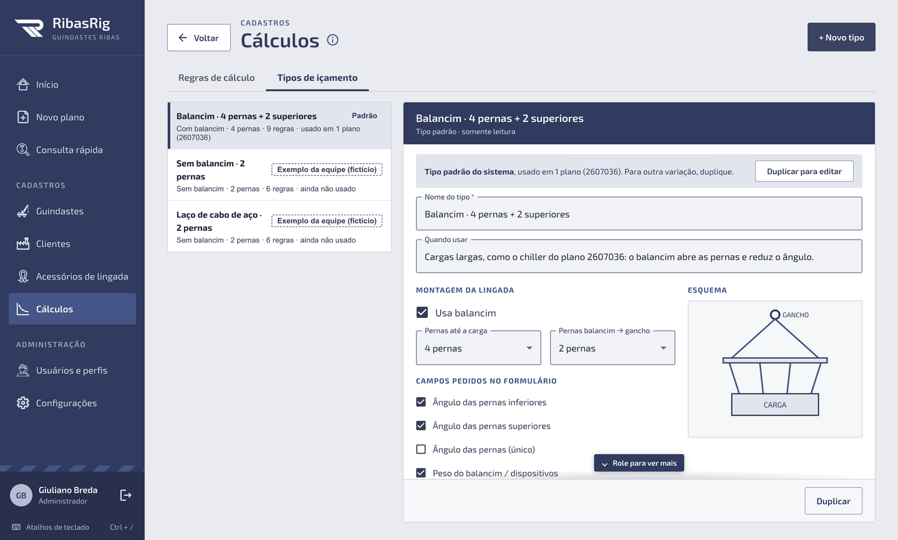 |

- **Regras de cálculo:** cada fórmula com suas variáveis, unidade e um **teste ao vivo** com os valores do plano 2607036.
  Use `+ − × ÷ ^`, parênteses, `cos`, `sen`, `tg` (em graus), `raiz`, `min`, `max`, `abs`, vírgula decimal e `;`
  entre argumentos (ex.: `max(3; 45)`). As regras do sistema são só leitura: use **Duplicar** para criar uma variação.
  Cada gravação vira uma nova versão, e os planos emitidos guardam a versão usada.
- **Tipos de içamento:** com ou sem balancim, número de pernas, campos pedidos no formulário e as regras de
  referência. As montagens aceitas são as que o cálculo cobre: **sem balancim, 2 ou 4 pernas**; **com balancim, 4 pernas
  até a carga e 2 do balancim ao gancho**. Um tipo antigo com outra montagem bloqueia a emissão até ser ajustado.
- **O que o cálculo usa:** cintas, manilhas e taxa do guindaste saem das fórmulas do sistema (as mesmas das regras
  padrão). As regras criadas ou duplicadas ficam no catálogo e no tipo como referência e documentação; elas ainda
  não mudam o resultado do plano.

---

## 9. Administração

### Usuários e perfis

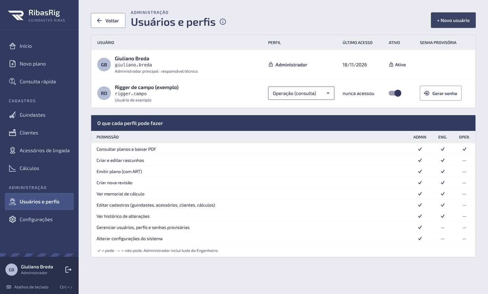

- **Novo usuário:** nome, usuário (letras minúsculas, números, ponto, hífen ou sublinhado) e perfil. O sistema mostra
  a **senha provisória uma vez**: anote e entregue à pessoa.
- **Gerar senha provisória** para quem esqueceu a senha (a anterior deixa de valer na hora).
- Mudar perfil ou desativar. O **administrador principal** não pode ser desativado nem mudar de perfil.

### Configurações

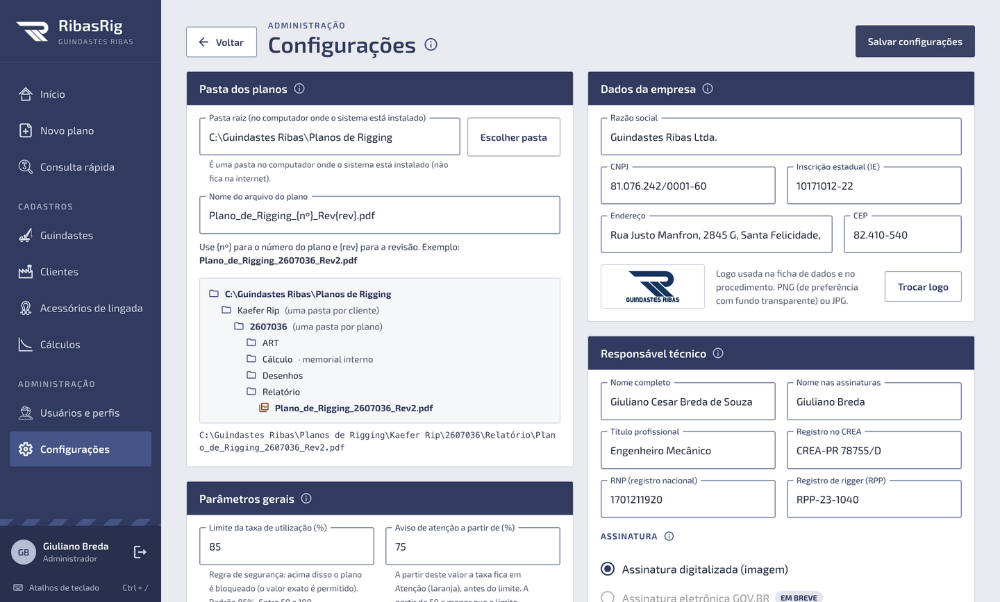

- **Pasta dos planos:** a pasta raiz no computador (o botão **Escolher pasta** abre o seletor) e o modelo do nome do
  arquivo, com `{nº}` e `{rev}`.
- **Dados da empresa** e **logo** (PNG ou JPG; vale para os PDFs emitidos depois).
- **Responsável técnico:** nome, título, CREA, RNP, RPP e a assinatura digitalizada (guardada no servidor; por
  enquanto o PDF mostra o nome e o registro nas linhas de assinatura).
- **Parâmetros gerais:** o **limite da taxa de utilização** (padrão 85%, entre 50% e 100%; acima dele o plano é bloqueado), o
  aviso de atenção (a partir de 50% e menor que o limite) e o vento padrão (0 a 20 m/s). Ao salvar um limite
  diferente, o sistema pede confirmação. O novo limite vale para os rascunhos e as próximas emissões; as revisões já
  emitidas guardam o limite usado na emissão.

---

## 10. Onde ficam os arquivos

O servidor guarda **todos** os dados e documentos (banco PostgreSQL e volume de arquivos). O aplicativo grava uma
**cópia** dos documentos na pasta dos planos, organizada assim:

```
<pasta raiz>                                  (Configurações › Pasta dos planos)
└── Kaefer Rip                                (nome da pasta do cliente)
    └── 2607036                               (nº do plano)
        ├── Relatório/Plano_de_Rigging_2607036_Rev2.pdf    PDF do cliente
        ├── Cálculo/Memorial_2607036_Rev2.pdf              memorial interno
        └── Desenhos/Carimbo_2607036.xlsx                  planilha do carimbo
```

Por segurança, o aplicativo só grava PDF e planilha, só dentro dessa pasta, e só abre arquivos que ele mesmo gravou.

---

## 11. Problemas comuns

| mensagem ou situação | o que fazer |
|---|---|
| "O servidor do RibasRig está fora do ar" | Servidor neste computador: abra o Docker Desktop e espere ele ficar pronto; o aplicativo tenta de novo sozinho. Servidor dedicado: confira a internet. Se continuar, chame quem cuida do servidor. |
| "Usuário ou senha incorretos." | Confira o usuário (minúsculas) e a senha. Se esqueceu, peça uma senha provisória ao administrador. |
| "Muitas tentativas seguidas. Aguarde N segundos…" | Espere o tempo indicado e tente de novo. |
| "Senha provisória vencida." | A senha provisória vale 48 horas: peça outra ao administrador. |
| O plano aparece como **Bloqueado** | Abra a etapa 6: o checklist mostra o motivo e o botão "Ir para etapa". |
| "Plano … emitido não pode ser alterado." | Abra o plano e use **Criar nova revisão**. |
| A ART do plano não é aceita | O número tem 13 dígitos, não pode estar em outro plano e o PDF precisa se chamar `ART_<nº>.pdf`. |
| "O arquivo não é um PDF válido." | O arquivo está corrompido ou não é PDF. Gere o PDF de novo e anexe. |
| "Plano emitido, mas o PDF não foi salvo na pasta" | O plano foi emitido. Confira a pasta em Configurações (ela precisa existir e permitir gravação) e use **Abrir PDF** na tela do plano. |
| "… salvo, mas o PDF do laudo/certificado não foi enviado" | O cadastro foi salvo; anexe o PDF de novo e salve. |
| Esqueci a senha do administrador principal | Só quem cuida do servidor pode trocar (pelo terminal; está em [docs/backend.md](docs/backend.md)). |
