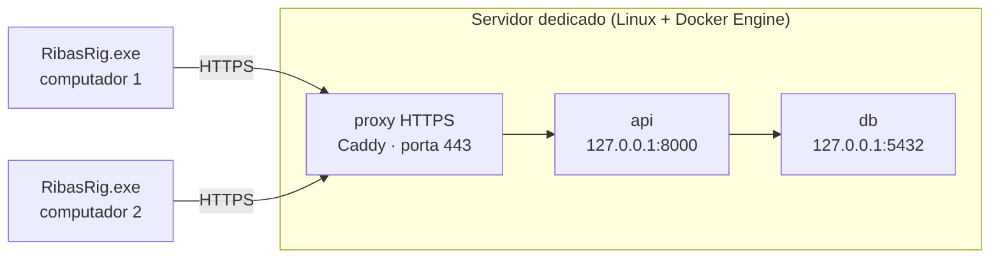

# RibasRig · Back-end (`ribasrig-backend/`)

API REST do Sistema RibasRig (Guindastes Ribas Ltda.): guarda os planos de rigging e os cadastros,
**recalcula o plano no servidor antes de emitir**, grava cada revisão emitida de forma imutável e gera os
documentos (PDF do plano, memorial de cálculo e planilha do carimbo).
Jornada de Aprendizagem · 6º semestre de Engenharia de Software · UniSENAI PR.

**Stack:** Python 3.13 · Django 5.2 LTS · Django REST Framework 3.16 · SimpleJWT · PostgreSQL 17 · ReportLab + pypdf
(PDF) · openpyxl (planilha) · Docker Compose.
O contrato (endpoints, nomes, erros) é o de `src/services/api.ts` e `src/domain/types.ts` do `ribasrig-frontend`.
Visão geral do sistema: [README](../README.md), [guia do usuário](../GUIA_DO_USUARIO.md) e [arquitetura](../ARQUITETURA.md).
Os comandos abaixo rodam dentro da pasta `ribasrig-backend/`.

> **Onde o servidor roda.** Por enquanto o back-end foi testado e roda **só numa máquina local**: o Docker Compose
> no próprio computador, com a API e o banco em `127.0.0.1`. O **cenário ideal é um servidor dedicado** (ex.: uma VPS)
> que todos os computadores da empresa acessam por HTTPS. O código já está preparado para isso, mas a implantação ainda
> não foi feita nem testada: veja [Servidor dedicado (VPS)](#servidor-dedicado-vps).

---

## Como rodar (servidor local)

Pré-requisito: Docker Desktop aberto.

```bash
cp .env.example .env          # preencha POSTGRES_PASSWORD, DJANGO_SECRET_KEY e (opcional) RIBASRIG_SENHA_TESTE
docker compose up -d --build  # 1. sobe PostgreSQL + API em http://127.0.0.1:8000/api/ (migra o banco sozinho)
docker compose exec api python manage.py carregar_exemplo   # 2. opcional: cenário de demonstração
```

A ordem importa: o `exec` roda dentro do container da API, então o passo 2 só funciona com o passo 1 no ar
(se ele disser que a API não está pronta, espere alguns segundos e repita).

Gere a `DJANGO_SECRET_KEY` com `python3 -c "import secrets; print(secrets.token_urlsafe(50))"`.

O `carregar_exemplo` cria o cenário do mock do front (planos 2607036, 2610001, 2610002 e os cadastros) e os
usuários de teste `giuliano.breda` (Administrador) e `rigger.campo` (Operação), com a senha de
`RIBASRIG_SENHA_TESTE` (vazia = senha aleatória mostrada **uma vez** no terminal). Enquanto o servidor for local, cada computador tem o
seu banco e o seu `.env`, então a senha de teste é a de cada máquina. Só roda em banco vazio.

Para um uso real (sem dados de exemplo), crie o primeiro administrador à mão e cadastre os demais pela tela Usuários:

```bash
docker compose exec api python manage.py createsuperuser
```

A API e o banco só escutam em `127.0.0.1`: nada fica exposto na rede, e só o próprio computador acessa o servidor.
Para um servidor dedicado, veja [Servidor dedicado (VPS)](#servidor-dedicado-vps).

### Comandos do dia a dia

| comando | o que faz |
|---|---|
| `docker compose up -d` | liga o servidor com a imagem que já existe (dados preservados) |
| `docker compose up -d --build` | reconstrói a imagem depois de mudar o código do back-end (dados preservados) |
| `docker compose ps` · `docker compose logs -f api` | situação dos containers · log da API (erros 500 aparecem aqui) |
| `docker compose stop` · `docker compose down` | desliga · desliga e remove os containers (**dados preservados** nos volumes) |
| `docker compose down -v` | remove containers **e os volumes**: apaga banco e arquivos. Não tem volta |
| `docker compose exec api python manage.py changepassword <usuário>` | troca a senha de um usuário existente |

### Backup e restauração

Os dados ficam em dois volumes: `banco` (PostgreSQL) e `arquivos` (PDFs enviados e gerados). Faça cópia dos dois
antes de atualizar o Docker ou o sistema operacional (uma reinstalação do Docker Desktop pode apagar os volumes):

```bash
docker compose exec -T db pg_dump -U ribasrig -Fc ribasrig > backup-banco.dump
docker compose cp api:/dados/arquivos ./backup-arquivos
# restaurar (banco vazio, com o servidor no ar):
docker compose exec -T db pg_restore -U ribasrig -d ribasrig --clean --if-exists < backup-banco.dump
docker compose cp ./backup-arquivos/. api:/dados/arquivos
docker compose exec -u root api chown -R ribasrig /dados/arquivos   # o cp grava como root; a API precisa escrever
```

### Problemas comuns

- **`Hash Sum mismatch` no build** (passo do `apt-get`): o espelho do Debian estava sincronizando. O Dockerfile já
  tenta de novo; se ainda falhar, espere alguns minutos ou use `docker compose up -d` (sem `--build`) com a imagem que
  já existe.
- **Login recusado depois de recriar o banco**: rode o `carregar_exemplo` (com o servidor no ar) ou crie um usuário.
- **"Muitas tentativas seguidas"**: o limite de login é 10 por minuto por endereço (`RIBASRIG_LIMITE_LOGIN`); espere
  o tempo indicado.
- **Porta 5432 ou 8000 ocupada**: outro PostgreSQL ou outro servidor está usando a porta; desligue-o ou mude a porta
  no `docker-compose.yml`.

## Servidor dedicado (VPS)

> **Ainda não testado.** Até aqui o sistema só rodou em máquina local. Este é o passo a passo previsto para o cenário
> ideal: **um servidor dedicado para o back-end**, com **um banco só para toda a equipe** (no servidor local, cada
> computador tem o seu). Não é preciso mudar código, só a configuração.



1. **Servidor:** Linux com Docker Engine e o plugin `docker compose` (não precisa de Docker Desktop). Copie o
   repositório e entre em `ribasrig-backend/`.
2. **`.env`** (a partir do `.env.example`), com senha e chave novas:

   | variável | valor na VPS |
   |---|---|
   | `DJANGO_DEBUG` | `0` |
   | `DJANGO_ALLOWED_HOSTS` | o domínio, ex.: `ribasrig.exemplo.com.br` |
   | `RIBASRIG_PROXIES` | `1` (o IP do usuário vem do proxy; vale para o limite de tentativas de login) |
   | `RIBASRIG_HOJE` | **vazio** (data real; `2026-10-07` é só da demonstração) |
   | `RIBASRIG_SENHA_TESTE` | vazio (sem usuários de teste) |

3. **Portas:** mantenha o `docker-compose.yml` como está (API e banco em `127.0.0.1`). Quem fica exposto é só um
   proxy HTTPS na própria VPS. Com o [Caddy](https://caddyserver.com/), que obtém o certificado sozinho, o
   `Caddyfile` é:

   ```
   ribasrig.exemplo.com.br {
       reverse_proxy 127.0.0.1:8000
   }
   ```

   No firewall, abra só as portas 22 (SSH), 80 e 443. O PostgreSQL nunca fica acessível de fora.
4. **Subir e criar o primeiro administrador:** `docker compose up -d --build` e
   `docker compose exec api python manage.py createsuperuser`. Não rode o `carregar_exemplo`.
5. **Levar os dados do servidor local** (opcional): faça o backup na máquina local e a restauração na VPS, com os
   comandos de [Backup e restauração](#backup-e-restauração).
6. **Backup agendado:** os mesmos comandos de backup num `cron` diário, com a cópia guardada **fora** da VPS.
7. **Computadores:** em cada um, o `configuracao.json` do aplicativo só com o endereço do servidor
   (`{ "api": "https://ribasrig.exemplo.com.br" }`, ver [docs/desktop.md](desktop.md#instalar-no-computador-da-empresa)).
   Sem `backend`, o aplicativo não tenta subir o Docker; se o servidor cair, mostra a página "fora do ar".
8. **Atualizar o sistema:** baixe a versão nova e rode `docker compose up -d --build` (as migrações rodam sozinhas).

## Desenvolvimento e testes

```bash
python3 -m venv .venv && .venv/bin/pip install -r requirements-dev.txt   # Python 3.13 ou mais novo
docker compose up -d db       # só o PostgreSQL (o .env já é lido pelo settings)
DJANGO_DEBUG=1 .venv/bin/python manage.py migrate
DJANGO_DEBUG=1 .venv/bin/python manage.py runserver   # o Vite do front redireciona /api para cá
.venv/bin/pytest              # motor, API e documentos, num banco de teste no mesmo PostgreSQL
```

A CI (`.github/workflows/backend.yml`, na raiz) roda `check --deploy`, confere migrações pendentes e roda o pytest num PostgreSQL 17.
O `check --deploy` mostra dois avisos esperados (W004 HSTS e W008 redirecionamento HTTPS): o servidor é local, em
HTTP, em `127.0.0.1`; num servidor remoto, o HTTPS fica num proxy na frente do Django. O aviso de CSRF (W003) foi
silenciado no `settings.py` porque a API não usa sessão nem cookie, só JWT no cabeçalho.

O teste de ponta a ponta (front + este servidor) fica no `ribasrig-frontend`; veja [docs/frontend.md](frontend.md#como-rodar).

## Organização

```
config/         settings (tudo vem de variáveis de ambiente), URLs e erros 404/500 em JSON
motor/          Motor de cálculo em Python puro e Decimal (sem Django). Espelha src/domain do front:
                calculos.py (gráfico, trações, sapatas, laudo, inspeção), plano.py (calcularPlano, checklist,
                bloqueios, cópia da revisão), validacao.py (faixas), numeracao.py, regras.py (avaliador seguro)
cenario/        Cenário de exemplo (o mesmo mock do front), usado pelo carregar_exemplo e pelos testes
nucleo/         Configurações, arquivos enviados, erros {"detail"}, "hoje", campos numéricos
contas/         Usuário (perfil, senha provisória), login JWT com limite de tentativas, matriz de permissões
cadastros/      Clientes, guindastes (laudos, gráficos de carga), acessórios (inspeções, histórico),
                padrões de inspeção, regras de cálculo (versões) e tipos de içamento
planos/         Plano de Rigging, lingada, guindastes adicionais, revisões, histórico, numeração, emissão
planos/documentos/  PDF do plano, memorial de cálculo e planilha do carimbo
tests/          test_motor_* (casos de aceitação do 2607036) e test_api_* (endpoints, permissões, regras, documentos)
```

## Endpoints

Todos exigem `Authorization: Bearer <access>`, menos login, refresh, logout, trocar-senha e sistema.
JSON em `snake_case`; o front converte num lugar só (`paraApi`/`daApi`). Números saem como número JSON (não texto).

| endpoint | quem | o que faz |
|---|---|---|
| `POST /api/auth/token/` | todos | `{usuario, senha}` → `{access, refresh, usuario}`. Com senha provisória: `{trocar_senha: true, usuario}` **sem token** |
| `POST /api/auth/token/refresh/` · `POST /api/auth/logout/` | todos | renova (com rotação) · invalida o refresh |
| `GET /api/auth/me/` | logado | perfil vindo do servidor |
| `POST /api/auth/trocar-senha/` | todos | `{usuario, senha_atual, senha_nova}` (primeiro acesso e redefinição) |
| `GET/POST /api/planos/` · `GET/PATCH /api/planos/{nº}/` | consultar · editar rascunhos | número gerado pelo servidor; emitido recusa PATCH com 409 |
| `POST /api/planos/{nº}/emitir/` | emitir | recalcula; se pode, cria a Rev. N+1 e gera PDF e memorial (422 com os motivos se não) |
| `POST /api/planos/{nº}/nova-revisao/` · `/duplicar/` · `POST /api/planos/lote/` | nova revisão · editar rascunhos | `lote`: `{dados, quantidade}` |
| `GET /api/planos/{nº}/historico/` | ver histórico | eventos do mais novo para o mais antigo |
| `POST/GET/DELETE /api/planos/{nº}/anexos/{desenhos\|art}/` | editar rascunhos (GET: consultar) | PDF (multipart, campo `arquivo`) |
| `GET /api/planos/{nº}/revisoes/{rev}/pdf/` | consultar | PDF único do cliente (`?baixar=1` = anexo); revisão do Excel: 409 |
| `GET /api/planos/{nº}/revisoes/{rev}/memorial/` | ver memorial | memorial de cálculo interno (PDF) |
| `GET /api/planos/{nº}/carimbo/` | editar rascunhos | `Carimbo_{nº}.xlsx` com nomes definidos (NUMERO_PLANO, ART, ESFORCO_SAPATAS_KGF…) |
| `GET/POST /api/guindastes/` · `PUT /api/guindastes/{id}/` | todos veem · editar cadastros | com laudos e gráficos de carga |
| `POST/GET /api/guindastes/{id}/laudo/arquivo/` | editar cadastros | PDF do laudo vigente |
| `GET/POST /api/acessorios/` · `PUT /api/acessorios/{id}/` · `/desativar/` · `/reativar/` | todos veem · editar cadastros | |
| `POST /api/acessorios/{id}/inspecoes/` · `POST/GET /api/acessorios/{id}/certificado/` | editar cadastros | inspeção pelo padrão · PDF do certificado |
| `GET /api/padroes-inspecao/` · `PUT /api/padroes-inspecao/{tipo}/` | todos veem · editar cadastros | |
| `GET/POST /api/clientes/` · `PUT /api/clientes/{id}/` | todos veem · editar cadastros | locais de obra vão juntos |
| `/api/regras/` · `/api/tipos-icamento/` (GET, POST, PUT `{id}`, DELETE `{id}`) | todos veem · editar cadastros | itens do sistema são só leitura (409) |
| `GET/POST /api/usuarios/` · `PATCH /api/usuarios/{id}/` · `POST /api/usuarios/{id}/senha-provisoria/` | Administrador | senha provisória aparece uma vez |
| `GET/PUT /api/configuracoes/` · `POST/GET /api/configuracoes/{logo\|assinatura}/` | todos veem · Administrador | logo e assinatura só PNG/JPEG |
| `GET /api/sistema/` | sem login | `{hoje, versao, limite_pct}`: o front usa este "hoje" e este limite nas regras |

Erros: sempre `{"detail": "mensagem"}`, inclusive em URL inexistente e em erro inesperado:
400 dados inválidos · 401 login · 403 sem permissão · 404 não encontrado · 409 conflito (ex.: plano emitido) ·
422 regra de negócio (ex.: não dá para emitir) · 429 tentativas demais · 500 erro inesperado (o detalhe vai só para o
log do servidor).

## Regras e limites do servidor

Por que cada proteção existe e como as partes se encaixam: [arquitetura](../ARQUITETURA.md#10-segurança). Aqui, o que o
servidor faz e com que valores:

- **Cálculo:** `motor/` é a tradução de `src/domain` do front, em `Decimal`. Os testes usam os valores do plano 2607036
  (Pb 3.746,62 kg; 9.260 kg no raio de 5,0 m; 40,46% / 46,52% / 58,36% / 17,76% / 68,09%; ES 7.940,68 kgf;
  RMET 3,1763).
- **Limite da taxa de utilização:** `Configuracoes.limite_pct`, padrão 85, entre 50 e 100, alterado só pelo
  Administrador (`PUT /api/configuracoes/`); o aviso de atenção precisa ficar abaixo dele. A revisão grava o limite usado
  (`entradas.limite_pct`), e o memorial mostra esse valor.
- **Emissão:** recalcula com os cadastros atuais; só emite com o checklist completo e a situação ≠ Bloqueado. Revisão,
  PDF e memorial na mesma transação.
- **Revisão:** cópia das entradas e dos resultados em `Revisao.entradas`/`resultados`; o trigger da migração
  `planos/0002` recusa `UPDATE`/`DELETE` em `planos_revisao`.
- **Numeração:** AAMM + 3 dígitos, linha do mês travada em `SequenciaMensal` (`SELECT … FOR UPDATE`).
- **Sessão:** access de 15 min, refresh de 12 h com rotação e lista de bloqueio; trocar ou redefinir a senha derruba
  os tokens. Senha provisória aleatória, de uso único, válida por 48 h (`RIBASRIG_SENHA_PROVISORIA_HORAS`).
- **Limite de tentativas:** 10 por minuto por IP no login e na troca de senha (`RIBASRIG_LIMITE_LOGIN`), contado em
  todos os processos do gunicorn (cache em arquivo). O IP é o da conexão (`RIBASRIG_PROXIES=0`).
- **Uploads:** só pelo endpoint de anexo (nome de anexo no JSON do plano é ignorado); PDF conferido pelos bytes
  (`%PDF-`), logo e assinatura só PNG/JPEG; até 25 MB (`RIBASRIG_TAMANHO_MAX_PDF_MB`); nome no disco gerado pelo
  servidor, fora de pasta pública.
- **Entrada inválida:** número com dígitos demais, data inexistente ou JSON malformado respondem 400.
- **Fórmulas do engenheiro:** avaliador próprio (`motor/regras.py`, nunca `eval`), até 500 caracteres e expoente 100.
- **Caminhos:** pasta raiz e nome do arquivo conferidos (sem `..`, sem pasta no nome).

## Variáveis de ambiente

| variável | padrão | uso |
|---|---|---|
| `POSTGRES_DB` / `POSTGRES_USER` / `POSTGRES_PASSWORD` | ribasrig / ribasrig / — | banco (docker-compose) |
| `DATABASE_URL` | montada dos `POSTGRES_*` | conexão (fora do Docker aponta para localhost) |
| `DJANGO_SECRET_KEY` | — (obrigatória sem DEBUG) | assinatura dos tokens |
| `DJANGO_DEBUG` | 0 | desenvolvimento |
| `DJANGO_ALLOWED_HOSTS` | localhost,127.0.0.1 | nomes aceitos no cabeçalho Host |
| `RIBASRIG_HOJE` | vazio (data real) | "hoje" das regras; `2026-10-07` para a demonstração (igual ao HOJE do front). Data inválida impede a partida |
| `RIBASRIG_SENHA_TESTE` | vazio | senha dos usuários de teste do `carregar_exemplo` |
| `RIBASRIG_ARQUIVOS_DIR` | `dados/arquivos` (Docker: volume `arquivos`) | onde ficam os PDFs e imagens |
| `RIBASRIG_LIMITE_LOGIN` | 10/min | limite de tentativas de login e troca de senha, por IP |
| `RIBASRIG_PROXIES` | 0 | proxies de confiança na frente do Django (1 atrás de um proxy HTTPS) |
| `RIBASRIG_TAMANHO_MAX_PDF_MB` | 25 | tamanho máximo de um PDF enviado |
| `RIBASRIG_SENHA_PROVISORIA_HORAS` | 48 | validade da senha provisória |
| `RIBASRIG_LOG` | INFO | nível do log |
| `RIBASRIG_CACHE_DIR` | `<tmp>/ribasrig-cache` | cache em arquivo (contador do limite de tentativas) |
| `RIBASRIG_FONTE` / `RIBASRIG_FONTE_NEGRITO` | DejaVu (Docker) | fonte TrueType dos PDFs fora do Docker |

## Documentos gerados

- **PDF do plano** (`planos/documentos/pdf_plano.py`), gerado na emissão, na ordem da empresa: ficha de dados →
  desenhos → ART do plano → procedimento operacional → laudo do guindaste. Ficha e procedimento têm o mesmo
  conteúdo da visualização do front (`Documento.tsx`); os anexos entram sem alteração. Anexo ilegível impede a
  emissão (422); anexo que não está guardado (revisões do cenário de exemplo) vira uma página de aviso. Revisões
  emitidas antes da geração automática ganham o PDF no primeiro pedido; nelas, anexo ilegível também vira aviso,
  porque a revisão não pode mais ser corrigida.
- **Memorial de cálculo** (`pdf_memorial.py`), também na emissão: as mesmas seções de `visualizacao/memorial.ts`.
- Os dois ficam presos à revisão (`DocumentoRevisao`) e são montados só da cópia gravada na emissão (contratante,
  guindaste, empresa, responsável, arquivos): mudar um cadastro depois não muda um PDF emitido.
- **Planilha do carimbo** (`carimbo.py`): rascunho usa o cálculo atual; emitido, a cópia gravada na última revisão
  (como o PDF).
- Fonte: DejaVu no Docker (acentos e símbolos ≤ ÷ α →); fora do Docker, Arial Unicode ou a Vera do ReportLab.
  Todo texto do usuário é escapado antes de ir para o PDF. A logo enviada em Configurações substitui a da
  Guindastes Ribas nos PDFs emitidos depois.

## Ainda falta

- **ART do laudo do guindaste** como arquivo separado: hoje o PDF final inclui o laudo vigente; se a ART do laudo
  vier em outro PDF, ela precisa de um envio próprio.
- **Assinatura digitalizada nos PDFs:** a imagem já é enviada e guardada (`/api/configuracoes/assinatura/`), mas a
  ficha ainda mostra só o nome e o registro nas linhas de assinatura.
- **Servidor dedicado (VPS):** hoje o sistema só foi testado em máquina local. O passo a passo para o cenário ideal
  está em [Servidor dedicado (VPS)](#servidor-dedicado-vps), mas ainda não foi feito num servidor real.
